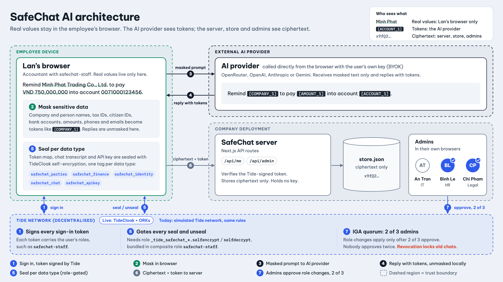
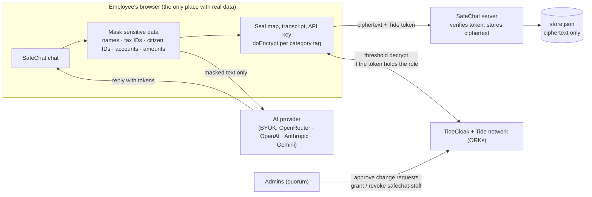

# SafeChat AI

**Demo video (2 min):** [demo/safechat-ai-demo.mp4](demo/safechat-ai-demo.mp4)

[](https://tide.org/tidecloak?utm_source=github&utm_medium=readme&utm_campaign=unlocked)

## Project overview

_SafeChat AI is a company AI assistant where employees paste real documents, yet no AI vendor, admin or server can read the real data alone._

Built with [TideCloak](https://tide.org/tidecloak?utm_source=github&utm_medium=readme&utm_campaign=unlocked).

### 1. Vision & originality

Company AI today is a super-account: it reads everything, and admins can export every prompt. SafeChat flips that. Names, tax codes, IDs, amounts and accounts are masked in the browser, and the key to unmask them is sealed per category with TideCloak. The AI works on tokens; only the employee sees real values.

### 2. Trust constraint insight

Employees avoid company AI because IT can read every prompt, so they paste data into personal AI instead. Companies fear the reverse: leavers keep customer data in their chat history, and one prompt injection (as in Copilot's EchoLeak) can leak everything the AI can reach. Today you must trust the vendor, the admins and the AI at once.

### 3. Value & impact

Lan, an accountant at a 50-person Vietnamese firm, can ask AI to chase a VND 750 million debt or check payroll without exposing a client or colleague. Her company gets AI adoption without shadow AI, and clean offboarding.

### 4. Why TideCloak matters

Decryption needs the Tide network and a role in a threshold-signed token. Granting or revoking `safechat-staff` is a change request a quorum of admins must approve. So the server holds no key, no single admin can grant themselves access, and a revoked employee is cut off cryptographically, not by a flag.

### 5. Prototype & storytelling

Watch the "What the AI provider sees" panel: tokens only. Normal AI mode leaks the same names. Even if the injected email fools the AI, its exfiltration link carries only tokens. The admin view shows ciphertext. Revoke Lan: her chats seal shut.

## Status on 22 October: simulated Tide network

During the hackathon Tide's network was under heavy load: our realm was provisioned on the live network, but enrolling a Tide account kept failing (`Could not reach enough NEW ORKs (got 1 of 20 required)`). Tide then asked teams to *"build your prototype as though TideCloak protects it and simulate those protections for now. It's judged exactly the same as a live integration."*

So SafeChat runs by default against a **simulated Tide network** (`lib/sim-tide`, served at `/api/sim-tide`, with its state kept apart from SafeChat's own store). It enforces the same rules SafeChat relies on:

- self-encryption bound to one user and gated by the `_tide_<tag>.selfencrypt` / `.selfdecrypt` roles,
- composite role `safechat-staff`, and `safechat-auditor` for the admin view,
- role changes that take effect only after Tide's IGA quorum (`max(1, floor(0.7 × admins))`, i.e. 2 of 3), with no admin approving twice.

The live integration is in the same code path (`TideCloakProvider`, `doEncrypt`/`doDecrypt`, `verifyTideCloakToken`, `init/realm.json` with the SafeChat roles and IGA): set `NEXT_PUBLIC_TIDE_MODE=live` once the network is healthy. Where each TideCloak feature fits, as planned with Tide's MCP: [docs/tidecloak-integration-plan.md](docs/tidecloak-integration-plan.md).

## Architecture





| Who | Sees | Cannot |
|---|---|---|
| AI provider | Masked text such as `[COMPANY_1]`, `[AMOUNT_1]` | Know which company, person or amount |
| SafeChat server / database | Ciphertext, plus usernames, chat ids and timestamps | Decrypt any chat, key or map: it holds no key |
| A single admin | Who has chats | Read them, or grant themselves `safechat-staff` without the quorum |
| The employee | Everything, in their own Tide session | Keep reading after the quorum revokes them |

## Honest limits

- What an employee already saw or copied before leaving cannot be taken back; SafeChat protects the stored history.
- Masking is pattern-based (citizen ID, tax ID, phone, account, amount, company and honorific-name patterns plus custom terms) and can miss free-form secrets; users can add terms to always mask.
- Whoever holds a live session holds that user's authority (Tide's own documented limit).
- The quorum only means something with several admins: TideCloak's approval threshold is 70% of admins, so the demo realm needs at least three enrolled admins for a real 2-of-3. With a single admin, that admin approves their own changes.
- Whoever serves SafeChat's JavaScript could ship a modified page that reads plaintext in the browser. SafeChat removes stored-data and server-side risk; it does not remove the need to trust the code you load (the same is true of any web E2EE).
- Data is synthetic. The bank, payment and company systems are not real.

## Setup

Requirements: Node.js 20.9+.

**Simulated Tide network (default)**

```bash
npm install
npm run dev         # http://localhost:3100, sign in as Lan (employee) or An / Binh / Chi (admins)
npm test            # masking, sealing, storage and simulated-network tests
```

Sign in as Lan, open **Key settings** and paste your own AI key (OpenRouter, OpenAI, Anthropic or Gemini).

**Live TideCloak** (Docker, `curl`, `jq` as well)

```bash
# 1. TideCloak (dev image wired to the Tide network)
docker run -d --name tidecloak -p 8080:8080 \
  -v "$PWD/.tidecloak-data:/opt/keycloak/data/h2" \
  -e KC_BOOTSTRAP_ADMIN_USERNAME=admin -e KC_BOOTSTRAP_ADMIN_PASSWORD="$KC_PASSWORD" \
  tideorg/tidecloak-dev:latest

# 2. Realm "safechat" with the SafeChat roles (init/realm.json), licensed to your email
NEW_REALM_NAME=safechat CLIENT_NAME=safechat-web CLIENT_APP_URL=http://localhost:3100 \
KC_USER=admin KC_PASSWORD="$KC_PASSWORD" SUBSCRIPTION_EMAIL=you@example.com \
npm run init        # open the printed link to enrol the first admin

# 3. App against the live network
npm install
NEXT_PUBLIC_TIDE_MODE=live npm run dev
```

Then in the TideCloak console assign `safechat-staff` to employees and `safechat-auditor` to admins (each change needs the admin quorum).

## Credits

Team NMAB, RMIT Hackathon 2026 (SGS), Challenge 2. Everything here, including the BYOK provider client, masking, sealing, the simulated Tide network and the UI, was built during the hackathon.
